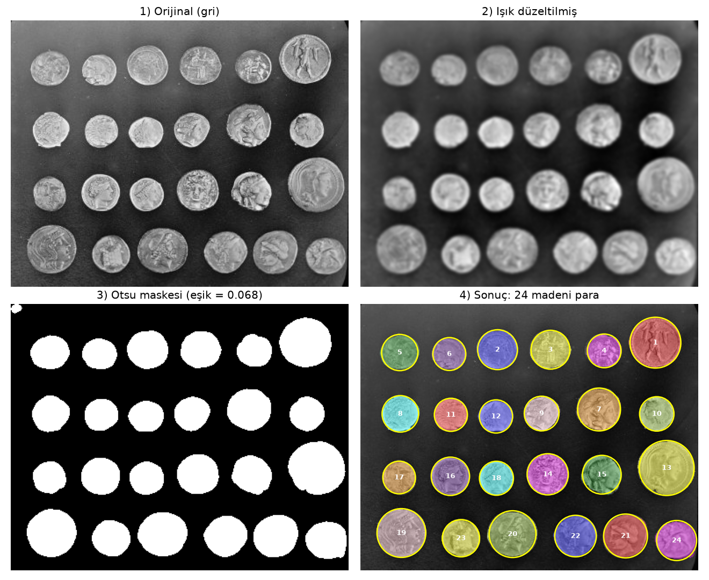

# Madeni Para Sayıcı

Bir görüntüdeki madeni paraları **yapay zekâ kullanmadan**, yalnızca klasik görüntü işleme yöntemleriyle sayan Python projesi.

YMS 301 · Python'a Hızlı Geçiş · 4. Hafta: *Modüller ve Dosya Yapısı*, Bilim Köşesi örneği (`klasik.py`) temel alınarak modüler bir paket olarak geliştirildi.



## Yöntem

| Adım | İşlem | Kullanılan fonksiyon |
|---|---|---|
| 1 | Işık düzeltme: küçük Gauss bulanıklığından büyük Gauss bulanıklığı (arka plan) çıkarılır | `skimage.filters.gaussian` |
| 2 | Otsu eşikleme: görüntü otomatik olarak siyah/beyaza ayrılır | `skimage.filters.threshold_otsu` |
| 3 | Delik doldurma ve morfolojik açma: paraların içindeki boşluklar kapatılır, gürültüye bağlanan ince köprüler koparılır | `scipy.ndimage.binary_fill_holes`, `binary_opening` |
| 4 | Bağlı bileşen etiketleme: birbirine değen beyaz pikseller tek bölge sayılır | `skimage.measure.label` |
| 5 | Alan filtresi: `MIN_ALAN` değerinden küçük bölgeler gürültü kabul edilip atılır | `skimage.measure.regionprops` |

Ders notundaki kısaltılmış kod hazır `coins` görüntüsünde **27** bölge bulur, çünkü 3 küçük gürültü lekesini de para sayar. Bu projede eklenen alan filtresi ve morfolojik açma sayesinde sonuç, gerçek para sayısı olan **24** çıkar. Bu sonuç farklı arka plan sigma değerlerinde (20, 30, 40, 60) de aynı kalır.

## Klasör yapısı

```
.
├── main.py                 # Komut satırı giriş noktası (if __name__ == "__main__")
├── para_sayici/            # Paket
│   ├── __init__.py
│   ├── ayarlar.py          # Sabitler: bağımlılık zincirinin en altı
│   ├── goruntu.py          # Görüntü yükleme, griye çevirme
│   ├── klasik.py           # Algoritma
│   ├── rapor.py            # JSON rapor
│   └── gorsel.py           # 4 panelli PNG
├── ornekler/               # Para sayısı bilinen test görüntüleri + üretici
│   └── uret.py
├── tests/
│   └── test_para_sayici.py
└── requirements.txt
```

Bağımlılıklar tek yönde akar, bu yüzden döngüsel import oluşmaz:
`main.py → klasik / rapor / gorsel → goruntu → ayarlar`

## Kurulum

```bash
python -m venv .venv
.venv\Scripts\activate        # Linux/Mac: source .venv/bin/activate
pip install -r requirements.txt
```

## Kullanım

```bash
python main.py                          # hazır örnek görüntü -> 24 para
python main.py resim.jpg                # kendi görüntünüz
python main.py resim.jpg --ters         # paralar arka plandan koyuysa
python main.py --min-alan 600 --sigma-arkaplan 60 --cikti sonuc
python -m para_sayici.klasik            # sadece algoritmayı çalıştır
```

Çıktılar `cikti/` klasörüne yazılır:

- `sonuclar.json`: para sayısı ve her paranın merkezi, alanı, yarıçapı
- `adimlar.png`: algoritmanın 4 adımını gösteren görsel

Kod içinden kullanım:

```python
from para_sayici import madeni_para_say

sonuc = madeni_para_say()
print(sonuc.sayi)  # 24
```

## Örnek test görüntüleri

`ornekler/` klasöründe para sayısı bilinen 7 görüntü bulunur. Dosya adındaki sayı, görüntüdeki gerçek para sayısıdır.

| Görüntü | Para | Neyi sınar | Komut |
|---|---|---|---|
| `coins_renkli.png` | 24 | RGB → gri dönüşümü | `python main.py ornekler/coins_renkli.png` |
| `coins_ters.png` | 24 | Koyu para, açık zemin | `python main.py ornekler/coins_ters.png --ters` |
| `coins_golgeli.png` | 24 | Güçlü eşit olmayan ışık | `python main.py ornekler/coins_golgeli.png` |
| `sentetik_12.png` | 12 | Dağınık, farklı boyutlu paralar | `python main.py ornekler/sentetik_12.png` |
| `sentetik_7_gurultulu.png` | 7 | Yoğun kamera gürültüsü | `python main.py ornekler/sentetik_7_gurultulu.png` |
| `sentetik_9_koyu_para.png` | 9 | Koyu para, açık masa | `python main.py ornekler/sentetik_9_koyu_para.png --ters` |
| `bos_masa.png` | 0 | Para yokken sahte para uydurmama | `python main.py ornekler/bos_masa.png` |

Görüntüler sabit tohumla üretildiği için her seferinde aynı çıkar. Yeniden üretmek için: `python -m ornekler.uret`

## Testler

```bash
python -m unittest -v
```
